# 02 – Pipeline de Integración Continua (CI)

## Resumen

El pipeline corre en cada pull request hacia `main` y en cada merge a `main`. Hoy:

- Compila y prueba con **Maven + JUnit**, y mide la cobertura con **JaCoCo** (pruebas unitarias y de Quarkus combinadas).
- Detecta secretos con **Gitleaks** y **Secret scanning**.
- Revisa la calidad del código con **SonarQube Cloud** (autenticado con OIDC, sin secretos guardados).
- Analiza la seguridad del código con **CodeQL**.
- Revisa las dependencias con **Trivy** y las mantiene al día con **Dependabot**.
- Construye la imagen con **Jib** y escanea todas sus capas con **Trivy**.
- Corre una prueba de rendimiento ligera con **k6** sobre la imagen construida.
- **Bloquea el merge** a `main` si cualquiera de esos controles falla.

## Flujo del pipeline

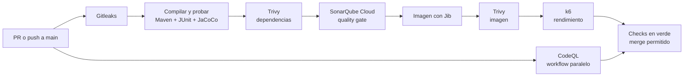

Criterio de orden: primero los controles rápidos que pueden detener el pipeline, luego compilación y pruebas,
y al final los pasos que necesitan resultados anteriores (análisis, imagen, rendimiento).

## Stages del pipeline

El pipeline como código está en `.github/workflows/ci.yml` (equivalente en GitHub Actions a un Jenkinsfile).
Sus steps se agrupan en estas etapas lógicas:

| # | Stage | Steps en `ci.yml` | Justificación del orden |
|---|---|---|---|
| 1 | Checkout | Descargar el código (`fetch-depth: 0`) | Todo lo demás necesita el código; el historial completo lo usan Gitleaks y SonarQube |
| 2 | Detección de secretos | Gitleaks | Control rápido: no se compila un cambio que expone credenciales |
| 3 | Compilación y pruebas | Instalar Java · `./mvnw -B verify` · reportes de pruebas y cobertura | Núcleo del CI; genera la cobertura que usa SonarQube |
| 4 | Análisis de dependencias | Trivy (`fs`) | Necesita las dependencias ya resueltas por Maven (`~/.m2`) |
| 5 | Calidad de código | Caché · autenticación OIDC · SonarQube + *quality gate* | Necesita clases compiladas y `jacoco.xml` |
| 6 | Construcción de la imagen | Jib (etiqueta = SHA del commit) | Solo se empaqueta lo que pasó pruebas, seguridad y calidad |
| 7 | Escaneo de la imagen | Trivy (`image`) | Revisa sistema base y Java antes de cualquier publicación |
| 8 | Prueba de rendimiento | Levantar contenedor · k6 · resultados · detener contenedor | Se prueba el artefacto real que se desplegaría |
| — | SAST (workflow paralelo) | CodeQL en `codeql.yml` | Requiere `security-events: write`; separado para no ampliar permisos del CI |

Criterio general: primero los controles rápidos que pueden detener el pipeline; después, los que dependen de
resultados anteriores. Cualquier stage en rojo bloquea el merge a `main` (Paso 10).

## Archivos del pipeline

| Archivo | Función |
|---|---|
| `.github/workflows/ci.yml` | Pipeline principal (job `Compilar, probar y analizar`) |
| `.github/workflows/codeql.yml` | SAST con CodeQL (job `Análisis de seguridad (CodeQL)`) |
| `.github/dependabot.yml` | Actualizaciones automáticas de Maven y GitHub Actions |
| `.trivyignore` | Excepciones de vulnerabilidades, justificadas y con vencimiento |
| `.sdkmanrc` | Versiones de Java/Maven del proyecto |
| `k6/smoke.js` | Prueba de rendimiento |

## Flujo de trabajo (se repite en cada paso)

```bash
git checkout main && git pull                 # partir de main actualizado
git checkout -b feature/<nombre>              # rama del cambio
./mvnw -B verify                              # validar localmente
git add <archivos>
git commit -m "<mensaje>"
git push -u origin feature/<nombre>
gh pr create --base main --title "<título>" --body "<descripción>"   # dispara el CI
gh pr checks --watch                          # seguir el CI
gh pr merge --squash --delete-branch          # integrar si está en verde
```

Disparadores del CI (`on:` en `ci.yml`):

| Evento | Cuándo | Para qué |
|---|---|---|
| `pull_request` hacia `main` | Se abre un PR o se suben commits a uno abierto | Validar el cambio antes de integrarlo (GitHub prueba la combinación con `main`) |
| `push` a `main` | Merge de un PR | Validar la integración real |

---

## El servicio (punto de partida)

API REST que recibe el id de una PQR y devuelve uno de 10 mensajes al azar.

| Endpoint | Respuesta |
|---|---|
| `GET /pqr/{id}` | `{"id":"PQR-2026","mensaje":"La PQR PQR-2026 fue asignada a un asesor especializado."}` |
| `GET /q/health/ready` | Estado de la aplicación (sonda de Kubernetes) |

- El `id` solo admite letras, números y guiones (máx. 20); otro valor devuelve `400`.
- Inyección de dependencias por constructor.
- Pruebas: unitarias (`PqrServiceTest`), de API (`PqrResourceTest`, `@QuarkusTest`) y de demostración (`DemostracionProteccionRamaTest`).

---

## Paso 0. Base del pipeline

**Objetivo:** que el CI use las mismas versiones que el entorno local.
**Por qué:** evita el "en mi máquina funciona".
**Archivos:** `mvnw`, `mvnw.cmd`, `.mvn/`, `.sdkmanrc`, `.github/workflows/ci.yml`.

```bash
mvn wrapper:wrapper     # genera el Maven Wrapper
./mvnw -v               # verifica Maven y Java 25
sdk env init            # crea .sdkmanrc con la versión de Java activa
mkdir -p .github/workflows
```

Permisos del workflow (mínimo privilegio):

```yaml
permissions:
  contents: read      # solo lectura del repositorio
  id-token: write     # token OIDC para SonarQube Cloud
```

**Verificar:** pestaña **Actions**, ejecución en verde.

## Paso 1. Compilación y pruebas

**Objetivo:** compilar y ejecutar las pruebas en cada PR.
**Por qué:** retroalimentación rápida; un PR con pruebas fallidas no se integra.

```yaml
- uses: actions/checkout@v6
  with:
    fetch-depth: 0          # historial completo (Gitleaks y SonarQube)
- uses: actions/setup-java@v6
  with:
    distribution: temurin
    java-version: '25'
    cache: maven            # caché de ~/.m2
- run: ./mvnw -B verify
- if: always()              # guarda reportes aunque fallen las pruebas
  uses: actions/upload-artifact@v7
  with:
    name: reportes-pruebas
    path: target/surefire-reports/
```

**Verificar:** artefacto **reportes-pruebas** en la ejecución.

**Evidencia:**

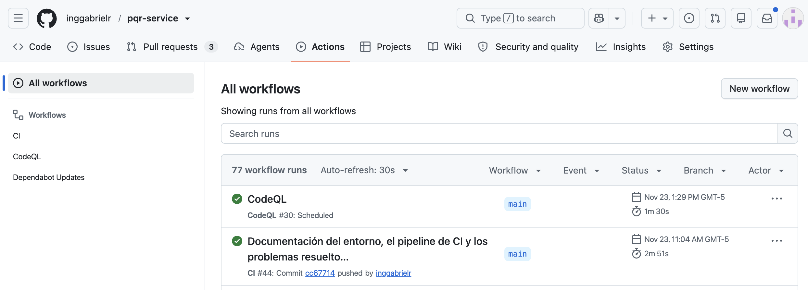

## Paso 2. Cobertura con JaCoCo

**Objetivo:** medir la cobertura de **todas** las pruebas (unitarias y `@QuarkusTest`).
**Por qué:** SonarQube la usa en su *quality gate*.
**Archivos:** `pom.xml`, `application-test.properties`.

`quarkus-jacoco` solo mide `@QuarkusTest`; `jacoco-maven-plugin` mide las unitarias y genera el reporte combinado.

```xml
<dependency>
    <groupId>io.quarkus</groupId>
    <artifactId>quarkus-jacoco</artifactId>
    <scope>test</scope>
</dependency>
```

```xml
<plugin>
    <groupId>org.jacoco</groupId>
    <artifactId>jacoco-maven-plugin</artifactId>
    <version>0.8.14</version>
    <executions>
        <execution>
            <id>default-prepare-agent</id>
            <goals><goal>prepare-agent</goal></goals>
            <configuration>
                <exclClassLoaders>*QuarkusClassLoader</exclClassLoaders>
                <destFile>${project.build.directory}/jacoco-quarkus.exec</destFile>
                <append>true</append>
            </configuration>
        </execution>
        <execution>
            <id>report</id>
            <phase>verify</phase>
            <goals><goal>report</goal></goals>
            <configuration>
                <dataFile>${project.build.directory}/jacoco-quarkus.exec</dataFile>
                <outputDirectory>${project.build.directory}/jacoco-report</outputDirectory>
            </configuration>
        </execution>
    </executions>
</plugin>
```

`application-test.properties`:

```properties
quarkus.jacoco.reuse-data-file=true   # no borrar los datos de las pruebas unitarias
quarkus.jacoco.report=false           # un solo reporte: el del plugin
```

**Verificar:** `open target/jacoco-report/index.html`; artefacto **reporte-cobertura** en el CI.

**Evidencia:**

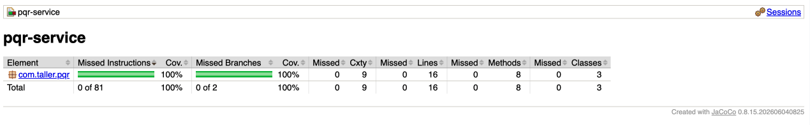

## Paso 3. Calidad con SonarQube Cloud

**Objetivo:** analizar calidad y bloquear el PR si el código nuevo no cumple el *quality gate* (Sonar way).
**Por qué:** detecta errores, *code smells*, duplicación y *hotspots* de seguridad.
**Archivos:** `pom.xml`, `ci.yml`.

Configuración en SonarQube Cloud:
1. Login con GitHub → importar la organización `inggabrielr` → instalar la app en el repo → plan gratuito.
2. Proyecto → **Administration → Analysis Method** → desactivar **Automatic Analysis**.
3. Organización → **Administration → Organization settings → Analysis** → activar **Secretless analysis for GitHub Actions**.

`pom.xml` (`<properties>`):

```xml
<sonar.host.url>https://sonarcloud.io</sonar.host.url>
<sonar.organization>inggabrielr</sonar.organization>
<sonar.projectKey>inggabrielr_pqr-service</sonar.projectKey>
<sonar.coverage.jacoco.xmlReportPaths>${project.build.directory}/jacoco-report/jacoco.xml</sonar.coverage.jacoco.xmlReportPaths>
```

`ci.yml`:

```yaml
- uses: actions/cache@v6
  with:
    path: ~/.sonar/cache
    key: ${{ runner.os }}-sonar
    restore-keys: ${{ runner.os }}-sonar
# OIDC: token temporal (30 min) sin secretos guardados; acción de terceros fijada por SHA
- uses: SonarSource/sonarqube-auth-action@b372e2c2930aadfcc4f4399446da1e12772709ad
- env:
    GITHUB_TOKEN: ${{ secrets.GITHUB_TOKEN }}
  run: ./mvnw -B org.sonarsource.scanner.maven:sonar-maven-plugin:sonar -Dsonar.qualitygate.wait=true
```

- No repite las pruebas: usa las clases compiladas y `jacoco.xml`.
- `sonar.qualitygate.wait=true` hace fallar el CI si el *quality gate* falla.

**Verificar:** en el log, `QUALITY GATE STATUS: PASSED`; comentario de SonarQube Cloud en el PR.

**Evidencia:**

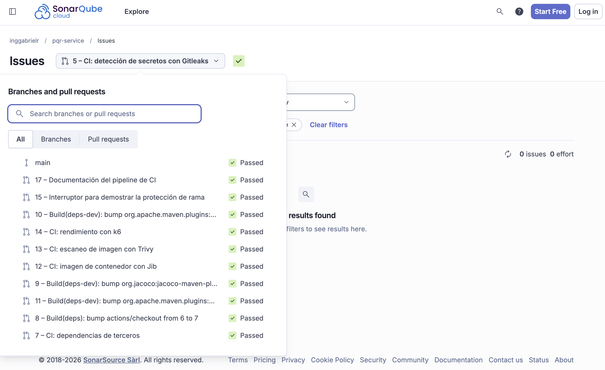

## Paso 4. Detección de secretos

**Objetivo:** impedir que credenciales lleguen al repositorio.
**Por qué:** un secreto en el historial de Git queda expuesto aunque se borre después.

| Capa | Dónde actúa | Detecta |
|---|---|---|
| Secret scanning + push protection (GitHub) | Al hacer `git push` | Credenciales de proveedores conocidos |
| Gitleaks (CI) | En cada PR, sobre todo el historial | También patrones genéricos (`api-key=...`) |

GitHub: **Settings → Advanced Security** → activar **Secret scanning** y **Push protection**.

`ci.yml` (después del checkout):

```yaml
- name: Detectar secretos con Gitleaks
  env:
    GITLEAKS_VERSION: 8.30.1
  run: |
    BASE_URL="https://github.com/gitleaks/gitleaks/releases/download/v${GITLEAKS_VERSION}"
    ARCHIVO="gitleaks_${GITLEAKS_VERSION}_linux_x64.tar.gz"
    curl --proto '=https' --tlsv1.2 -sSfL -O "${BASE_URL}/${ARCHIVO}"
    curl --proto '=https' --tlsv1.2 -sSfL -O "${BASE_URL}/gitleaks_${GITLEAKS_VERSION}_checksums.txt"
    sha256sum --check --ignore-missing "gitleaks_${GITLEAKS_VERSION}_checksums.txt"
    tar -xzf "${ARCHIVO}" gitleaks
    ./gitleaks git . --redact --verbose
```

- Descarga solo por HTTPS (también en redirecciones) y validada con *checksum* antes de ejecutar.
- `--redact` oculta el valor del secreto en el log.

**Prueba controlada:** rama con una propiedad `pqr.integracion.api-key=<32 caracteres hexadecimales aleatorios>` en `application.properties` → el CI falla en Gitleaks → cerrar el PR sin merge. El valor no se incluye aquí porque Gitleaks también lo detectaría en la documentación (ver [03 – Paso 4](03-problemas-y-soluciones.md#paso-4-detección-de-secretos)).

**Evidencia:**

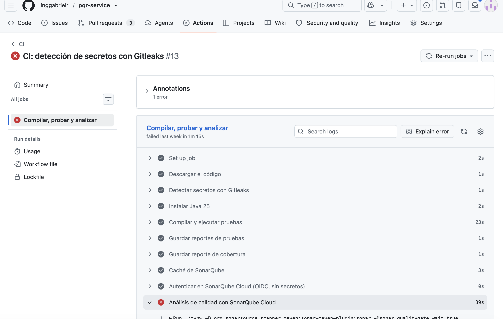

## Paso 5. Seguridad del código con CodeQL

**Objetivo:** análisis SAST del código propio (inyecciones, deserialización insegura, etc.).
**Por qué:** complementa a SonarQube con análisis especializado en flujo de datos.
**Archivo:** `.github/workflows/codeql.yml` (configuración avanzada; la "por defecto" debe estar desactivada en **Settings → Advanced Security**).

```yaml
on:
  pull_request: { branches: [ main ] }
  push: { branches: [ main ] }
  schedule:
    - cron: '27 6 * * 1'        # semanal: reglas nuevas sobre código sin cambios
permissions:
  contents: read
  security-events: write        # publicar hallazgos en Security
jobs:
  analyze:
    name: Análisis de seguridad (CodeQL)
    runs-on: ubuntu-latest
    steps:
      - uses: actions/checkout@v6
      - uses: github/codeql-action/init@v4
        with:
          languages: java-kotlin
          build-mode: none          # analiza sin compilar
          queries: security-extended
      - uses: github/codeql-action/analyze@v4
        with:
          category: /language:java-kotlin
```

Workflow separado: necesita `security-events: write` y así no amplía los permisos del CI principal.

**Verificar:** check **Análisis de seguridad (CodeQL)** en el PR; pestaña **Security → Code scanning**.

**Evidencia:**

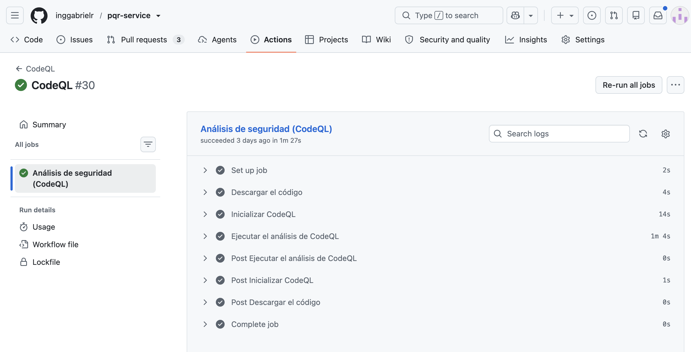

## Paso 6. Dependencias de terceros

**Objetivo:** bloquear dependencias con vulnerabilidades conocidas y mantenerlas actualizadas.

| Herramienta | Rol |
|---|---|
| Dependabot | Vigila `main`: alertas y PR automáticos de actualización (Maven y GitHub Actions) |
| Trivy (`fs`) | Bloquea el PR si trae dependencias ALTAS o CRÍTICAS con corrección disponible |

GitHub: **Settings → Advanced Security** → activar **Dependency graph**, **Dependabot alerts** y **Dependabot security updates**.

`.github/dependabot.yml`:

```yaml
version: 2
updates:
  - package-ecosystem: maven
    directory: "/"
    schedule: { interval: weekly }
    open-pull-requests-limit: 5
    groups:
      quarkus:
        patterns: [ "io.quarkus*" ]
  - package-ecosystem: github-actions
    directory: "/"
    schedule: { interval: weekly }
```

`ci.yml` (después de "Compilar y ejecutar pruebas"):

```yaml
- name: Revisar dependencias con Trivy
  env:
    TRIVY_VERSION: 0.76.2
  run: |
    BASE_URL="https://github.com/aquasecurity/trivy/releases/download/v${TRIVY_VERSION}"
    ARCHIVO="trivy_${TRIVY_VERSION}_Linux-64bit.tar.gz"
    curl --proto '=https' --tlsv1.2 -sSfL -O "${BASE_URL}/${ARCHIVO}"
    curl --proto '=https' --tlsv1.2 -sSfL -O "${BASE_URL}/trivy_${TRIVY_VERSION}_checksums.txt"
    sha256sum --check --ignore-missing "trivy_${TRIVY_VERSION}_checksums.txt"
    tar -xzf "${ARCHIVO}" trivy
    ./trivy fs . --scanners vuln --severity HIGH,CRITICAL --ignore-unfixed --offline-scan --exit-code 1
```

Va después de compilar: usa las dependencias ya descargadas en `~/.m2` (`--offline-scan`), sin consultar Maven Central.

**Prueba controlada:** rama con `org.apache.commons:commons-text:1.9` (CVE-2022-42889) → el CI falla en Trivy → cerrar el PR sin merge.

**Evidencia:**

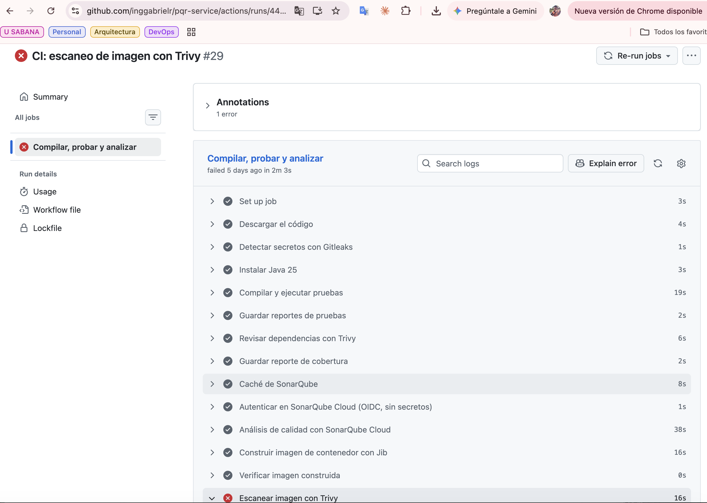

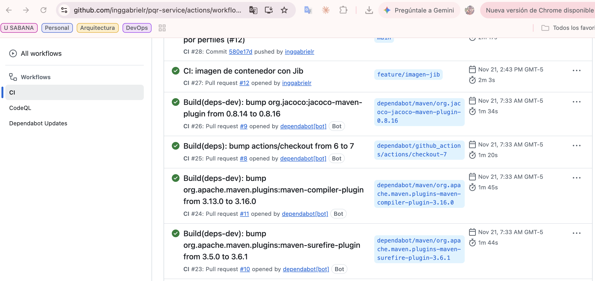

## Paso 7. Imagen de contenedor con Jib

**Objetivo:** empaquetar la aplicación como imagen, sin Dockerfile.
**Por qué:** es el artefacto que se desplegará en GKE; Jib separa capas y reconstruye solo lo que cambia.

```bash
./mvnw quarkus:add-extension -Dextensions="container-image-jib"
```

`application.properties`:

```properties
quarkus.container-image.group=taller
quarkus.container-image.name=pqr-service
quarkus.jib.base-jvm-image=registry.access.redhat.com/ubi9/openjdk-25-runtime:1.24-5
```

`ci.yml`:

```yaml
- name: Construir imagen de contenedor con Jib
  run: >
    ./mvnw -B package -DskipTests
    -Dquarkus.container-image.build=true
    -Dquarkus.container-image.tag=${{ github.sha }}
- name: Verificar imagen construida
  run: docker images taller/pqr-service
```

- Etiqueta = SHA del commit: cada imagen es rastreable hasta su código.
- Se construye, no se publica (la publicación en Artifact Registry corresponde al CD).

**Evidencia:**

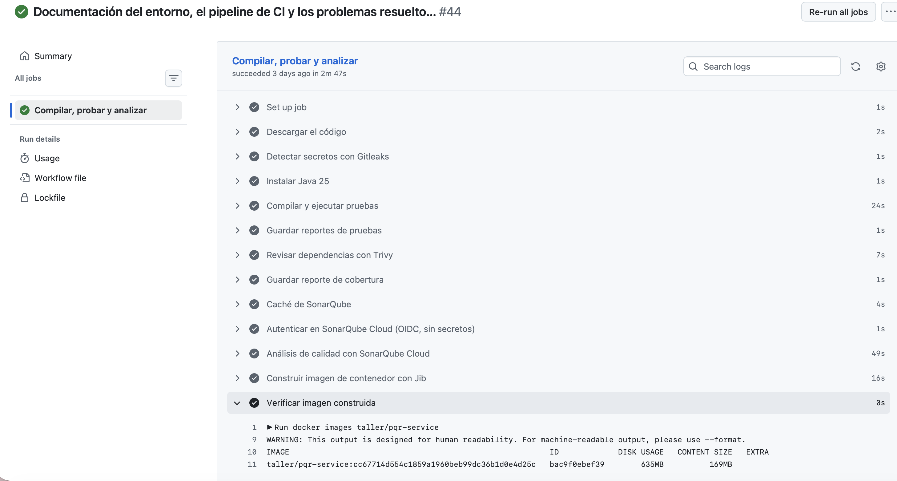

## Paso 8. Escaneo de la imagen con Trivy

**Objetivo:** revisar todas las capas de la imagen: sistema operativo base, Java y librerías.
**Por qué:** una imagen puede ser vulnerable por su imagen base aunque el código esté limpio.

```yaml
- name: Escanear imagen con Trivy
  run: >
    ./trivy image taller/pqr-service:${{ github.sha }}
    --scanners vuln --severity HIGH,CRITICAL --ignore-unfixed --offline-scan --exit-code 1
```

Imagen base fijada (`1.24-5`) tras comparar alternativas con Trivy; hallazgos residuales sin imagen corregida
documentados en `.trivyignore` con fecha de vencimiento (ver [03 – Paso 8](03-problemas-y-soluciones.md#paso-8-escaneo-de-la-imagen-con-trivy)).

```bash
# Consultar etiquetas y escanear una imagen base candidata
skopeo list-tags docker://registry.access.redhat.com/ubi9/openjdk-25-runtime | grep '"1\.' | tail -15
trivy image registry.access.redhat.com/ubi9/openjdk-25-runtime:1.24-5 --scanners vuln --severity HIGH,CRITICAL --ignore-unfixed
```

**Evidencia:**


## Paso 9. Rendimiento con k6

**Objetivo:** detectar regresiones graves de rendimiento sobre la imagen construida.
**Alcance:** prueba de humo (10 usuarios, 30 s). La prueba de carga real corresponde al ambiente de qa (CD).
**Archivos:** `k6/smoke.js`, `ci.yml`.

Umbrales de `k6/smoke.js`:

| Métrica | Umbral |
|---|---|
| `http_req_failed` | < 1 % |
| `http_req_duration` | p(95) < 500 ms |
| `checks` (status 200, id y mensaje correctos) | > 99 % |

`ci.yml`:

```yaml
- name: Levantar la imagen para la prueba de rendimiento
  run: |
    docker run -d --name pqr-service -p 8080:8080 taller/pqr-service:${{ github.sha }}
    for i in $(seq 1 30); do
      if curl -sf http://localhost:8080/q/health/ready > /dev/null; then echo "Servicio listo"; exit 0; fi
      sleep 2
    done
    echo "El servicio no estuvo listo a tiempo"; docker logs pqr-service; exit 1
- name: Prueba de rendimiento con k6
  env:
    K6_VERSION: 1.4.2
    BASE_URL: http://localhost:8080
  run: |
    BASE="https://github.com/grafana/k6/releases/download/v${K6_VERSION}"
    ARCHIVO="k6-v${K6_VERSION}-linux-amd64.tar.gz"
    cd "$RUNNER_TEMP"
    curl --proto '=https' --tlsv1.2 -sSfL -O "${BASE}/${ARCHIVO}"
    curl --proto '=https' --tlsv1.2 -sSfL -O "${BASE}/k6-v${K6_VERSION}-checksums.txt"
    sha256sum --check --ignore-missing "k6-v${K6_VERSION}-checksums.txt"
    tar -xzf "${ARCHIVO}" --strip-components=1 "k6-v${K6_VERSION}-linux-amd64/k6"
    cd "$GITHUB_WORKSPACE"
    "$RUNNER_TEMP/k6" run --summary-export k6-resumen.json k6/smoke.js
- if: always()
  uses: actions/upload-artifact@v7
  with:
    name: resultados-rendimiento
    path: k6-resumen.json
- if: always()
  run: docker rm -f pqr-service || true
```

**Verificar:** resumen de k6 con todos los umbrales en ✓; artefacto **resultados-rendimiento**.

**Evidencia:**

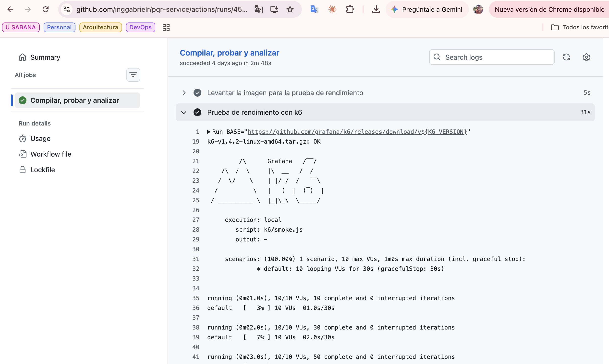

## Paso 10. Protección de la rama `main`

**Objetivo:** que ningún cambio llegue a `main` sin pasar por el pipeline.
**Por qué:** convierte las buenas prácticas en reglas obligatorias.

GitHub: **Settings → Rules → Rulesets → New branch ruleset**

| Opción | Valor |
|---|---|
| Nombre / estado | `proteccion-main` / **Active** |
| Bypass list | Vacía (aplica también al dueño del repo) |
| Target | Default branch (`main`) |
| Restrict deletions | Activa |
| Block force pushes | Activa |
| Require a pull request before merging | Activa; **0 aprobaciones** (un solo desarrollador); resolver conversaciones; solo **Squash** |
| Require status checks to pass | Activa; rama actualizada; checks `Compilar, probar y analizar` y `Análisis de seguridad (CodeQL)` |

### Demostración del bloqueo

Prueba de demostración `DemostracionProteccionRamaTest` controlada por la propiedad `taller.demo.fallo-ci`
en `application-test.properties`:

| Valor | Efecto |
|---|---|
| `false` (siempre en `main`) | La prueba se omite (`assumeTrue`) → CI en verde |
| `true` (solo en rama de prueba) | Falla con un mensaje "BLOQUEO INTENCIONAL" → merge bloqueado |

Diseño *fail-safe*: si queda en `true` por error, solo bloquea el merge.

```bash
git checkout -b test/proteccion-rama
# application-test.properties: taller.demo.fallo-ci=true
git commit -am "Demostración: activar el fallo intencional del CI"
git push -u origin test/proteccion-rama
gh pr create --base main --title "Demostración: protección de rama" --body "Debe quedar bloqueado"
gh pr checks --watch                                   # CI en rojo
gh pr merge --squash                                   # rechazado por GitHub
gh pr close test/proteccion-rama --delete-branch       # limpieza
```

Push directo a `main` (también debe ser rechazado):

```bash
git commit --allow-empty -m "Prueba: push directo a main" && git push
git reset --hard origin/main      # descartar el commit local de prueba
```

**Evidencia:**

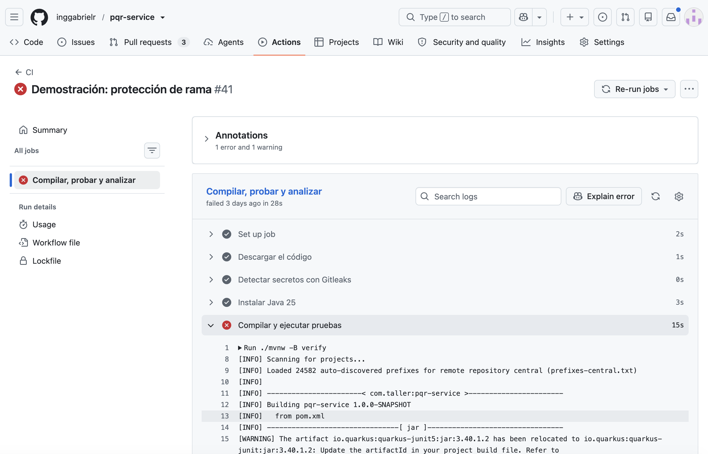

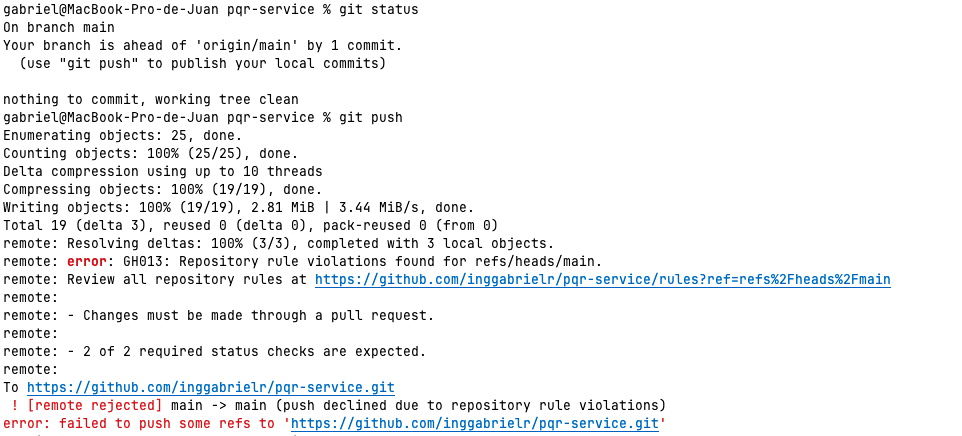

---

## Evidencias

Las capturas están en [`docs/evidencias/`](evidencias/) y se muestran en el paso correspondiente.
Nombre: `paso-<número>-<tema>.png`.

## Versiones de referencia (noviembre de 2026)

| Componente | Versión |
|---|---|
| Java / Quarkus | 25 (Temurin) / 3.40.1.2 (LTS) |
| JaCoCo | 0.8.14 |
| Gitleaks / Trivy / k6 | 8.30.1 / 0.76.2 / 1.4.2 |
| Imagen base | `ubi9/openjdk-25-runtime:1.24-5` |
| Acciones | `checkout@v6`, `setup-java@v6`, `upload-artifact@v7`, `cache@v6`, `codeql-action@v4` |

Las versiones de Gitleaks, Trivy y k6 se definen en variables del `ci.yml` y **Dependabot no las actualiza**;
revisarlas con `gh release list -R <dueño>/<repo> --limit 3`.
